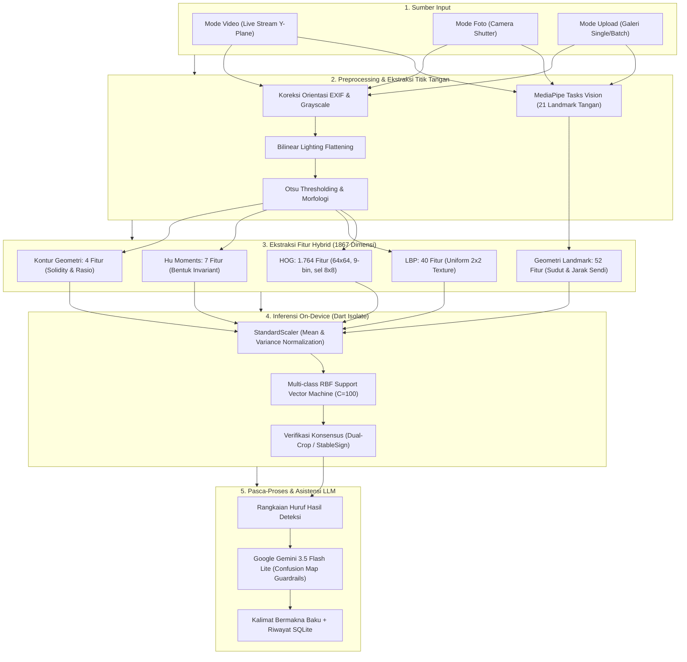

# Arsitektur & Alur Deteksi Hybrid SVM-HOG + MediaPipe + LLM

Dokumen ini menjelaskan arsitektur teknis sistem pengenalan 24 alfabet bahasa isyarat statis (A–Y, tanpa J dan Z) pada aplikasi **LatihIsyarat**, mulai dari preprocessing citra, ekstraksi fitur multimodal 1867-dimensi, eksekusi model on-device di background isolate, hingga koreksi cerdas berbasis LLM.

---

## 1. Diagram Alur Sistem End-to-End

---

## 2. Rincian Fitur Multimodal Hybrid (Total 1.867 Dimensi)

Model machine learning menggabungkan lima modalitas fitur representasi tangan untuk mencapai ketahanan (*robustness*) tinggi terhadap variasi bentuk tangan, sudut pengambilan, dan pencahayaan:

| No | Modalitas Fitur | Dimensi | Karakteristik & Representasi |
| :---: | :--- | :---: | :--- |
| 1 | **Histogram of Oriented Gradients (HOG)** | 1.764 | Menangkap orientasi gradien tepi jari dan telapak tangan pada jendela normalisasi 64×64 piksel (9 bin orientasi, cell 8×8, block 2×2, normalisasi L2-Hys). |
| 2 | **Local Binary Patterns (LBP)** | 40 | Pola biner seragam (*uniform LBP*) berukuran 2×2 untuk mendeskripsikan tekstur kulit dan lekukan lipatan sendi jari. |
| 3 | **Hu Invariant Moments** | 7 | Tujuh momen invarian bentuk yang tahan terhadap perubahan skala, translasi, dan rotasi siluet tangan. |
| 4 | **Contour Geometry Descriptors** | 4 | Properti geometri dasar: rasio luas area terhadap bounding box (*extent*), keliling, *aspect ratio*, dan kerapatan (*solidity*). |
| 5 | **MediaPipe Hand Landmarks** | 52 | Koordinat spasial dari 21 titik persendian tangan (3D X, Y, Z), jarak euclidean antarsendi yang dinormalisasi terhadap panjang telapak, serta sudut fleksi antarruas jari. |
| **Total** | **Vektor Fitur Hybrid** | **1.867** | **Disatukan dalam satu vektor dense sebelum masuk ke StandardScaler.** |

---

## 3. Inferensi On-Device di Background Isolate

Komputasi RBF SVM pada vektor 1867-dimensi memerlukan perkalian kernel matriks yang intensif. Agar antarmuka pengguna tidak mengalami *frame drop* (*jank*), arsitektur inferensi dirancang sebagai berikut:

* **Pemuatan Model Terkompresi**:
  Model tersimpan dalam format biner gzipped pada `assets/models/svm_hog.bin.gz` (~34.9 MB). Model memuat seluruh parameter penting: *support vectors*, *dual coefficients*, *intercepts*, *gamma*, *mean*, dan *scale*.
* **Dedicated Dart Isolate**:
  Saat aplikasi pertama kali memanggil `SvmHogClassifier.instance.initialize()`, sistem meluncurkan background isolate (`Isolate.spawn`) melalui fungsi `_serve`.
* **Zero-Copy Message Passing**:
  Data biner dikirim menggunakan `TransferableTypedData` untuk meminimalkan beban alokasi memori antar isolate. Isolate utama (UI) hanya mengirim permintaan inferensi dan menerima objek hasil akhir `SvmHogPrediction`.

---

## 4. Strategi Penstabil Deteksi & Konsensus

Untuk menghindari prediksi fluktuatif (*flickering*):

### A. Mode Video Real-Time (`StableSign`)
* Frame kamera diproses secara berkala (interval ~200–250 ms).
* Algoritma [`StableSign`](../lib/services/stable_sign.dart) menggunakan jendela geser (*sliding window*) 4 frame terakhir:
  * Huruf baru hanya dipancarkan jika minimal **3 dari 4 frame berurutan** menyepakati huruf yang sama.
  * Karakter yang sedang ditahan tidak akan dipancarkan berulang kali (*debounce*).
  * Jika tangan meninggalkan frame selama minimal 2 frame berturut-turut, status emisi direset secara otomatis.

### B. Mode Foto & Upload (Verifikasi Dual-Crop)
* Dari titik landmark tangan MediaPipe, sistem membentuk dua variasi crop:
  1. **Tight Crop**: Crop persegi rapat mengikuti batas terluar jari dengan sedikit padding.
  2. **Wide Crop**: Crop persegi lebih longgar mencakup area pergelangan tangan.
* Jika kedua variasi crop menghasilkan prediksi huruf yang identik, hasil ditandai sebagai `accepted = true`. Jika berbeda, hasil ditandai tidak sepakat untuk menghindari salah prediksi.

---

## 5. Integrasi LLM Autocorrect (Google Gemini 3.5 Flash Lite)

Pada mode latihan bebas, aliran huruf yang ditangkap kamera dikumpulkan menjadi deretan karakter tanpa spasi. Layanan [`LlmAutocorrectService`](../lib/services/llm_autocorrect_service.dart) bertugas menyempurnakan hasil deteksi:

* **SLA & Latency**:
  Menggunakan model `gemini-3.5-flash-lite` dengan batas waktu koneksi (*timeout*) ketat 4 detik dan pre-filter regex lokal sebelum memanggil API.
* **Confusion Map Guardrails**:
  LLM dibatasi oleh aturan keras (*strict system prompt*) yang hanya mengizinkan substitusi huruf berdasarkan kemiripan bentuk tangan isyarat fisik:
  * `M <-> N <-> E <-> S <-> A <-> T` (kluster kepalan tangan tertutup)
  * `U <-> V <-> R <-> K` (kluster jari telunjuk dan tengah tegak)
  * `B <-> W <-> F` (kluster telapak terbuka tegak)
  * `C <-> O` (kluster jari melengkung)
  * `G <-> H` (kluster jari horizontal)
  * `P <-> Q` (kluster jari menunduk)
  * `Y -> W / I`
* **Pemisahan Spasi**:
  Memisahkan rangkaian huruf gabungan menjadi kata-kata baku bahasa Indonesia (sesuai KBBI) atau bahasa Inggris umum (contoh: `"SAYAMAKANBAYAE"` $\rightarrow$ `"SAYA MAKAN BAYAM"`).

---

## 6. Persistensi Data Riwayat

Setiap sesi latihan yang selesai atau foto yang berhasil diprediksi dicatat ke dalam database SQLite (`sqflite`) melalui [`DatabaseHelper`](../lib/services/database_helper.dart) dengan metadata lengkap:
* `gesture`: Huruf atau kalimat hasil deteksi.
* `accuracy`: Tingkat keyakinan / status penerimaan konsensus.
* `date` & `time`: Waktu latihan.
* `source`: Sumber input (`video`, `photo`, atau `upload`).
* `model_id`: Identitas model yang digunakan (`svm_multimodal_contour_v3`).
* `image_path` / `video_path`: Path berkas media lokal.
