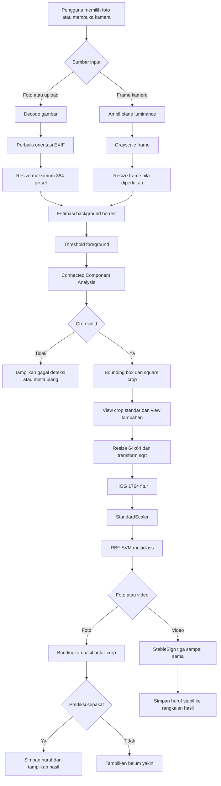
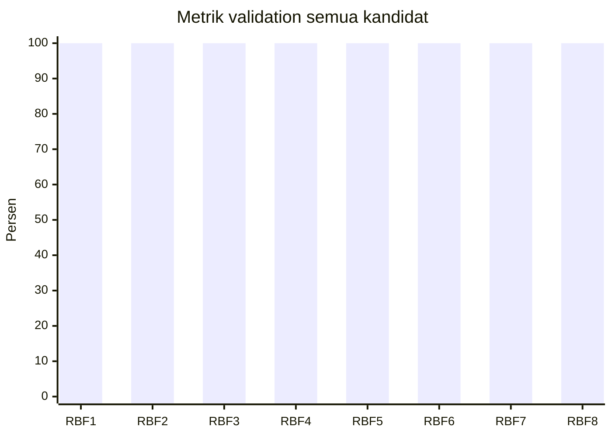

# Dokumentasi Training dan Alur Deteksi SVM-HOG

Dokumen ini menjelaskan proses eksperimen machine learning tradisional untuk mengenali 24 huruf bahasa isyarat statis. Penjelasan dimulai dari dataset dan training, kemudian dilanjutkan sampai foto pengguna diproses di aplikasi Flutter dan menghasilkan prediksi.

## 1. Ringkasan hasil

Model yang saat ini dipasang di aplikasi adalah RBF SVM dengan fitur HOG dan augmentasi training.

| Komponen | Nilai |
| --- | --- |
| Metode | HOG + StandardScaler + RBF SVM |
| Konfigurasi model terpasang | C = 100, gamma = `scale` |
| Kelas | 24 huruf statis A sampai Y tanpa J dan Z |
| Contoh training yang masuk ke model terpasang | 29.651 |
| Validation accuracy | 100% |
| Validation macro-F1 | 100% |
| Ukuran file joblib | 79.338.426 byte atau sekitar 75,66 MiB |
| Aset terkompresi di Flutter | 63.615.075 byte atau sekitar 60,69 MiB |
| Support vector | 10.446 |

Nilai validation 100% berarti seluruh gambar pada pembagian validation yang tercatat pada eksperimen tersebut diprediksi benar. Nilai ini tidak boleh langsung dianggap sebagai akurasi kamera nyata karena foto pengguna memiliki perbedaan pencahayaan, latar, jarak, sudut, dan bentuk tangan.

Official test khusus model augmented yang dipasang di aplikasi belum tersimpan di artefak final. Karena itu, laporan ini tidak mengklaim angka official test untuk model augmented.

Sebagai pembanding terpisah, artefak official test yang tersedia di repo berasal dari kandidat RBF C=100 gamma=`scale` tanpa augmentasi. Hasilnya adalah 6.880 benar dari 7.172 gambar, accuracy 95,9286%, dan macro-F1 95,6213%. Angka tersebut adalah hasil artefak tanpa augmentasi dan tidak boleh disebut sebagai hasil official test model augmented.

## 2. Dataset

Dataset yang digunakan adalah Sign Language MNIST dari `datamunge/sign-language-mnist`.

Dataset berisi gambar grayscale berukuran 28×28 piksel. Setiap gambar memiliki satu label huruf. Dataset benchmark ini memakai 24 kelas karena huruf J dan Z membutuhkan gerakan sehingga tidak tersedia sebagai pose statis.

Label yang didukung model adalah:

```text
A, B, C, D, E, F, G, H, I, K, L, M, N, O, P, Q, R, S, T, U, V, W, X, Y
```

Jumlah data berdasarkan manifest run training:

| Bagian data | Jumlah |
| --- | ---: |
| Data train resmi dari CSV | 27.455 |
| Data official test | 7.172 |
| Data asli untuk training setelah pembagian | 21.963 |
| Data validation | 5.492 |
| Duplikat piksel train yang dikeluarkan karena muncul di official test | 0 |

Data train resmi dibagi dengan `StratifiedGroupKFold` sebanyak 5 fold, seed 42, dan satu fold dipakai sebagai validation. Stratified berarti proporsi kelas dijaga. Grouping dilakukan berdasarkan hash piksel identik. Identitas orang atau sesi pengambilan foto tidak tersedia pada dataset, sehingga pemisahan berdasarkan signer tidak dapat diverifikasi.

Official test tetap disimpan terpisah dan tidak dipakai untuk memilih hyperparameter. Model dipilih dari hasil validation, kemudian official test dievaluasi setelah pilihan model dikunci.

## 3. Cara menjalankan training

Notebook utama untuk training berada di [TRAINING_SVM_HOG_COLAB.ipynb](D:/PBL_SEMESTER5/training/SVM_HOG/TRAINING_SVM_HOG_COLAB.ipynb).

Sumber Python yang dipakai notebook berada di [train_svm_hog.py](D:/PBL_SEMESTER5/training/SVM_HOG/train_svm_hog.py). Pada Colab, notebook sudah memuat seluruh fungsi sehingga file Python tidak perlu dijalankan terpisah.

Urutan menjalankan training di Google Colab adalah sebagai berikut.

1. Buka notebook di Google Colab.
2. Hubungkan Google Drive ketika diminta.
3. Jalankan semua cell dari awal sampai akhir.
4. Notebook mengunduh atau memakai cache dataset yang valid.
5. Notebook membagi data train menjadi training dan validation.
6. Notebook menghitung fitur HOG untuk setiap gambar.
7. Notebook melatih kandidat SVM satu per satu dan menyimpan checkpoint.
8. Notebook memilih kandidat berdasarkan macro-F1 validation, accuracy validation, lalu ukuran file jika nilainya sama.
9. Notebook mengevaluasi official test setelah pemilihan model selesai.
10. Notebook membuat laporan, confusion matrix, prediksi per gambar, bukti preprocessing, dan arsip hasil.

Implementasi ini menggunakan scikit-learn dan SVC. SVC pada notebook tidak menjalankan epoch neural network. Karena itu, log training menampilkan waktu fit per kandidat, bukan accuracy setiap epoch. Runtime GPU Colab tidak otomatis membuat SVC scikit-learn menjadi proses GPU.

## 4. Kandidat model yang dilatih

Pencarian hyperparameter memakai enam kandidat RBF tanpa augmentasi dan dua kandidat RBF dengan augmentasi.

| Kandidat | C | Gamma | Augmentasi | Data input | Validation accuracy | Validation macro-F1 | Ukuran model |
| --- | ---: | --- | --- | ---: | ---: | ---: | ---: |
| RBF 1 | 1 | `scale` | Tidak | 21.963 | 100% | 100% | 74.670.324 byte |
| RBF 2 | 1 | 0,001 | Tidak | 21.963 | 100% | 100% | 78.273.973 byte |
| RBF 3 | 10 | `scale` | Tidak | 21.963 | 100% | 100% | 74.543.087 byte |
| RBF 4 | 10 | 0,001 | Tidak | 21.963 | 100% | 100% | 78.197.555 byte |
| RBF 5 | 100 | `scale` | Tidak | 21.963 | 100% | 100% | 74.543.048 byte |
| RBF 6 | 100 | 0,001 | Tidak | 21.963 | 100% | 100% | 78.197.537 byte |
| RBF 7 | 100 | `scale` | Ya | 29.651 | 100% | 100% | 79.338.426 byte |
| RBF 8 | 10 | `scale` | Ya | 29.651 | 100% | 100% | 79.338.462 byte |

Semua kandidat tercatat konvergen. Kandidat augmented C=100 gamma=`scale` adalah artefak yang dipasang di Flutter karena dipakai sebagai kandidat eksperimen kamera. Validation tidak dapat membedakan kandidat tersebut dari kandidat tanpa augmentasi karena seluruhnya memperoleh 100%. Kandidat tanpa augmentasi C=100 gamma=`scale` memiliki file lebih kecil, sehingga status model harus selalu disebut berdasarkan artefak yang sedang dibahas.

## 5. Augmentasi data training

Augmentasi hanya dilakukan pada sebagian gambar training. Validation dan official test tidak diberi augmentasi.

Konfigurasi augmentasi yang tercatat adalah sebagai berikut.

| Transformasi | Rentang atau aturan |
| --- | --- |
| Rotasi | sampai ±10° |
| Pergeseran | sampai 5% pada sumbu x dan y |
| Skala | 0,9 sampai 1,1 |
| Contrast | 0,9 sampai 1,1 |
| Brightness | sekitar −10 sampai +10 |
| Gaussian blur | diterapkan secara acak pada sebagian gambar |
| Noise | noise Gaussian ringan dengan standar deviasi 2 |
| Proporsi | sekitar 35% gambar training asli, per kelas |

Sebanyak 7.688 gambar augmentasi diterima. Jumlah ini ditambahkan ke 21.963 gambar training asli sehingga total input kandidat augmented menjadi 29.651 gambar.

Tujuan augmentasi adalah membuat model melihat variasi kecil yang menyerupai kondisi kamera, misalnya tangan sedikit miring, bergeser, berbeda ukuran, lebih terang, lebih gelap, sedikit buram, atau memiliki noise. Augmentasi tidak menciptakan informasi jari baru. Jika bentuk tangan atau latar foto sangat berbeda dari dataset, augmentasi ini belum tentu cukup.

## 6. Proses sebelum masuk model

Bagian ini terjadi sebelum vektor fitur dikirim ke SVM. Training dataset MNIST dan foto aplikasi memiliki detail alur yang berbeda karena gambar MNIST sudah berupa crop 28×28, sedangkan foto pengguna masih berupa foto biasa.

### 6.1 Saat training dengan Sign Language MNIST

1. CSV dibaca dan kolom label dipisahkan dari 784 nilai piksel.
2. Nilai piksel disusun kembali menjadi gambar 28×28 grayscale.
3. Gambar diubah menjadi ukuran 64×64 agar sesuai dengan konfigurasi HOG.
4. Pada mode `full_frame`, segmentasi foreground tidak dipakai untuk gambar MNIST. Langkah ini mencegah gambar benchmark ditolak karena latarnya memang sudah berupa crop grayscale.
5. Jika bagian tersebut berasal dari subset augmentasi, transformasi rotasi, pergeseran, skala, pencahayaan, blur, dan noise diterapkan sebelum HOG.

### 6.2 Saat pengguna memasukkan foto ke aplikasi

Implementasi utama berada di [svm_hog_input.dart](D:/PBL_SEMESTER5/lib/services/svm_hog_input.dart).

1. **Decode gambar**

   File dibaca menjadi objek gambar. Format yang tidak dapat didecode ditolak.

2. **EXIF orientation correction**

   `bakeOrientation` menerapkan informasi orientasi dari metadata foto. Tujuannya agar gambar tidak miring karena orientasi kamera tersimpan di EXIF.

3. **Resize sumber**

   Sisi terpanjang foto diperkecil sampai maksimum 384 piksel. Tujuannya mengurangi beban memori dan waktu proses tanpa mengubah rasio gambar.

4. **Konversi grayscale**

   Setiap piksel warna diubah menjadi luminance dengan rumus:

   ```text
   0,299R + 0,587G + 0,114B
   ```

   Komponen hijau diberi bobot lebih besar karena mata manusia lebih sensitif terhadap luminance hijau.

5. **Estimasi background**

   Statistik piksel pada border foto dihitung. Nilai median border dipakai sebagai perkiraan warna latar.

6. **Foreground segmentation**

   Selisih intensitas terhadap background dipakai untuk memisahkan objek dari latar. Ini adalah segmentasi berbasis kontras, bukan pendeteksi tangan semantik.

7. **Connected Component Analysis**

   Piksel foreground yang saling terhubung dikelompokkan menjadi komponen. Komponen terbesar dipakai sebagai kandidat area tangan.

8. **Pemeriksaan kualitas crop**

   Foto ditolak jika resolusi terlalu kecil, objek terlalu kecil, objek memenuhi hampir seluruh gambar, ada komponen kedua yang besar, atau objek menyentuh tepi foto. Penolakan membantu mencegah gambar yang bentuknya tidak sesuai dikirim ke SVM.

9. **Bounding box dan square crop**

   Bounding box komponen terbesar diubah menjadi crop persegi. Crop diberi margin sekitar 1,05 dan 1,12 kali sisi objek. Area di luar gambar diisi memakai estimasi background.

10. **Resize menuju input HOG**

    Crop standar diubah melalui ukuran 28×28 lalu 64×64. Untuk pemeriksaan foto, aplikasi juga membuat beberapa view tambahan berupa inversi intensitas, resize 40×40 lalu 64×64, dan direct resize 64×64 pada kondisi pencahayaan tertentu.

11. **Koreksi pencahayaan tertentu**

    Jika pola pencahayaan pada border memenuhi pemeriksaan yang ditentukan, aplikasi mencoba meratakan pencahayaan. Koreksi ini hanya diterapkan jika pola border cukup konsisten agar tekstur tangan tidak ikut dirusak.

MediaPipe tidak digunakan sebagai crop utama pada branch SVM-HOG. Penggantinya adalah estimasi background, thresholding, connected component, bounding box, dan square crop. Akibatnya, foto dengan latar ramai atau kontras tangan yang rendah lebih mudah menghasilkan crop yang kurang tepat.

## 7. Ekstraksi fitur HOG

HOG adalah singkatan dari Histogram of Oriented Gradients. HOG tidak menyimpan warna sebagai ciri utama. HOG merangkum arah perubahan intensitas, sehingga bentuk tepi jari dan kontur tangan dapat direpresentasikan sebagai vektor angka.

Konfigurasi HOG yang dipakai:

| Parameter | Nilai |
| --- | --- |
| Ukuran input HOG | 64×64 piksel |
| Orientation bin | 9 arah |
| Ukuran cell | 8×8 piksel |
| Ukuran block | 2×2 cell |
| Normalisasi block | L2-Hys |
| Transformasi intensitas | `transform_sqrt = true` |
| Jumlah fitur | 1.764 |

Urutan perhitungan HOG adalah sebagai berikut.

1. Nilai piksel dibagi 255 sehingga berada pada rentang 0 sampai 1.
2. `transform_sqrt` menghitung akar kuadrat intensitas untuk mengurangi pengaruh perbedaan pencahayaan.
3. Gradien horizontal dan vertikal dihitung dari perubahan piksel tetangga.
4. Magnitude gradien menunjukkan kuatnya tepi.
5. Orientation gradien dipetakan ke rentang 0 sampai 180 derajat.
6. Magnitude dikumpulkan ke 9 histogram arah pada setiap cell.
7. Empat cell dalam satu block dinormalisasi dengan L2-Hys. Normalisasi ini membantu mengurangi pengaruh perubahan kontras.
8. Seluruh histogram block diratakan menjadi vektor 1.764 fitur.

Jumlah fitur dapat dihitung dari 7×7 posisi block, 4 cell per block, dan 9 bin arah.

```text
7 × 7 × 4 × 9 = 1.764 fitur
```

Ekstraksi ini otomatis dilakukan oleh kode HOG. Pengguna tidak menggambar edge atau memilih fitur satu per satu.

## 8. Proses di dalam model SVM

Implementasi inferensi berada di [svm_hog_model.dart](D:/PBL_SEMESTER5/lib/services/svm_hog_model.dart).

### 8.1 StandardScaler

Vektor HOG dari training dipakai untuk menghitung rata-rata dan skala setiap fitur. Nilai tersebut disimpan bersama model. Saat inference, setiap fitur diubah dengan rumus berikut.

```text
fitur_scaled = (fitur - mean_training) / scale_training
```

Scaler hanya dipelajari dari data training. Validation dan test hanya memakai nilai scaler yang sudah dipelajari, sehingga statistik test tidak masuk ke proses training.

### 8.2 RBF SVM

SVM mencari batas pemisah antar kelas. Model yang digunakan adalah kernel Radial Basis Function atau RBF. Kernel ini mengukur kemiripan non-linear antara vektor input dan support vector.

```text
K(x, v) = exp(-gamma × jarak_kuadrat(x, v))
```

Parameter pentingnya adalah:

- `C = 100` mengatur kompromi antara kesalahan klasifikasi dan kompleksitas batas pemisah
- `gamma = scale` menentukan skala pengaruh setiap support vector berdasarkan data fitur
- `kernel = rbf` memungkinkan batas pemisah non-linear
- `probability = false` sehingga model tidak menghasilkan probabilitas yang terkalibrasi

Model multiclass memakai klasifikasi pairwise. Untuk 24 kelas terdapat 276 pasangan classifier.

```text
24 × 23 / 2 = 276 pasangan
```

Setiap pasangan memberikan vote. Label dengan vote terbanyak menjadi prediksi. Aplikasi juga menghitung decision score untuk membantu pemeriksaan, tetapi decision score bukan persentase confidence yang terkalibrasi.

## 9. Postprocessing dan keputusan diterima

### 9.1 Foto satu gambar

Alur foto satu gambar adalah:

```text
File gambar
→ decode dan orientasi EXIF
→ grayscale
→ segmentasi foreground
→ connected component
→ square crop
→ beberapa view crop
→ HOG
→ StandardScaler
→ RBF SVM
→ pemeriksaan kesepakatan view
→ hasil huruf atau belum yakin
```

Jika crop standar menghasilkan label yang sama, prediksi dapat diterima. Jika dua crop menghasilkan label berbeda, aplikasi menampilkan status prediksi crop berbeda atau belum yakin. Tujuannya mencegah satu crop yang buruk langsung dianggap sebagai huruf benar.

### 9.2 Banyak gambar

Setiap gambar diproses satu per satu dengan alur yang sama. Hasil yang diterima dikumpulkan dalam urutan pemilihan gambar. Hasil yang ditolak atau belum yakin tetap diberi status agar pengguna dapat mengetahui foto mana yang perlu diulang.

### 9.3 Kamera dan video

Frame kamera mengambil plane luminance. Frame tersebut diproses melalui jalur grayscale, crop, HOG, scaler, dan SVM. Backend video memakai fungsi `classifyLuma`.

Untuk mencegah hasil yang berubah-ubah, [stable_sign.dart](D:/PBL_SEMESTER5/lib/services/stable_sign.dart) memakai aturan berikut.

1. Satu label harus muncul pada tiga sampel berturut-turut.
2. Label diterima satu kali selama pose yang sama masih ditahan.
3. Pose harus hilang beberapa sampel sebelum huruf yang sama dapat diterima kembali.
4. Frame tanpa foreground mengosongkan kandidat secara bertahap.

Aturan ini berfungsi sebagai stabilisasi temporal. Model tetap mengklasifikasikan frame per frame, sedangkan `StableSign` menentukan kapan prediksi dianggap cukup stabil untuk dimasukkan ke hasil.

## 10. Diagram alur keseluruhan



## 11. Alur training dan alur inference

```mermaid
flowchart LR
    A[Dataset MNIST 28x28 grayscale] --> B[Pembagian train dan validation]
    B --> C[Augmentasi subset training]
    C --> D[Resize 64x64]
    D --> E[HOG 1764 fitur]
    E --> F[StandardScaler training]
    F --> G[Training RBF SVM]
    G --> H[Validation dan pemilihan kandidat]
    H --> I[Model dan parameter diekspor]
    I --> J[Aset model Flutter]
    J --> K[Foto pengguna diproses dengan pipeline aplikasi]
    K --> L[HOG dan scaler yang sama]
    L --> M[Prediksi SVM]
    M --> N[Postprocessing aplikasi]
```



Training augmentation dan pemeriksaan multi-view aplikasi memiliki tujuan yang berhubungan, tetapi prosesnya berbeda. Augmentasi membuat contoh tambahan sebelum training. Multi-view membuat beberapa representasi dari satu foto saat inference. Foto pengguna tidak diubah menjadi data training secara otomatis.

## 12. Hasil validation dan official test

### 12.1 Validation

File sumbernya adalah [validation_comparison.csv](D:/PBL_SEMESTER5/training/SVM_HOG_FINAL_AUGMENTED/validation_comparison.csv).

Semua delapan kandidat yang tercatat konvergen dan memperoleh accuracy validation 100% serta macro-F1 validation 100%. Validation tidak menyimpan kolom micro-F1 terpisah.

Pada klasifikasi single-label multiclass, micro-F1 memiliki nilai yang sama dengan accuracy jika dihitung dari prediksi dan label yang sama. Oleh sebab itu, micro-F1 akan setara dengan 100% untuk validation tersebut bila dihitung. Namun angka itu adalah konsekuensi matematis dari accuracy, bukan kolom micro-F1 yang tersimpan sebagai hasil terpisah.

Validation CSV juga tidak menyimpan macro precision dan macro recall untuk setiap kandidat. Metrik precision, recall, weighted-F1, dan per kelas yang tersedia di repo berasal dari evaluasi official test artefak tanpa augmentasi dan ditampilkan terpisah di bawah.

Diagram ringkas hasil validation:



### 12.2 Official test yang tersedia

Official test tersedia pada artefak [official_test_evaluation.json](D:/PBL_SEMESTER5/training/svm_hog_mnist_fullframe_v2_ea951a2aa08a/official_test_evaluation.json). Artefak ini adalah kandidat tanpa augmentasi yang dievaluasi setelah pemilihan.

| Metrik | Hasil |
| --- | ---: |
| Total gambar | 7.172 |
| Benar | 6.880 |
| Salah | 292 |
| Ditolak preprocessing | 0 |
| Accuracy end-to-end | 95,9286% |
| Macro precision | 95,5697% |
| Macro recall | 96,0901% |
| Macro-F1 | 95,6213% |
| Weighted F1 | 95,9337% |

Kelas dengan F1 terendah pada artefak official test tersebut adalah R sebesar 81,0198%, U sebesar 83,0957%, N sebesar 84,6011%, dan M sebesar 87,1287%. Informasi ini menunjukkan bahwa validation yang sempurna belum berarti semua variasi gambar pada test akan sama mudahnya.

## 13. Hasil foto Drive dan hasil aplikasi Vivo

### 13.1 Uji delapan model pada foto Drive

File sumbernya adalah [REAL_PHOTO_TEST_REPORT.md](D:/PBL_SEMESTER5/training/SVM_HOG_FINAL_AUGMENTED/REAL_PHOTO_TEST_REPORT.md).

Dataset pengembangan ini berisi 24 foto A sampai Y tanpa J dan Z, lalu setiap foto diberi 15 variasi terkontrol.

| Model | Foto asli | Semua variasi |
| --- | ---: | ---: |
| RBF tanpa augmentasi | 4/24 atau 16,6667% | 63 sampai 66/384 atau 16,4062% sampai 17,1875% |
| RBF augmented C=100 gamma=`scale` | 6/24 atau 25% | 84/384 atau 21,875% |
| RBF augmented C=10 gamma=`scale` | 6/24 atau 25% | 84/384 atau 21,875% |

Hasil ini adalah evaluasi foto eksternal dengan preprocessing eksperimen yang tercatat pada laporan tersebut. Label foto berasal dari manifest folder dan bukan label resmi benchmark.

### 13.2 Uji 24 foto melalui aplikasi utama di Vivo

Pada uji terbaru melalui aplikasi utama, 24 foto Drive dipilih melalui menu upload banyak gambar.

| Hasil | Jumlah |
| --- | ---: |
| Benar | 14 |
| Salah | 7 |
| Belum yakin | 3 |
| Total | 24 |
| Accuracy huruf yang diterima | 14/24 atau 58,33% |

Prediksi berurutan yang tercatat adalah:

```text
A B E V E F G H I V L O N
Ragu Ragu Q V S Ragu V V V W D Y
```

Kesalahan yang tercatat adalah C menjadi E, D menjadi V, K menjadi V, M menjadi O, R menjadi V, U menjadi V, dan X menjadi D. Foto O menjadi N, P menjadi F, dan T menjadi M masuk status belum yakin.

Perbedaan angka 25% pada uji model langsung dan 58,33% pada uji aplikasi menunjukkan bahwa hasil sangat dipengaruhi jalur preprocessing, aturan multi-view, dan keputusan penerimaan. Keduanya tidak boleh diperlakukan sebagai satu dataset atau satu protokol yang sama.

## 14. Format model untuk aplikasi Flutter

File `.joblib` adalah artefak Python untuk training dan pemeriksaan. Flutter tidak memuat file joblib secara langsung. Pada tahap integrasi, parameter SVM diekspor menjadi aset biner terkompresi [svm_hog.bin.gz](D:/PBL_SEMESTER5/assets/models/svm_hog.bin.gz).

Aset tersebut memuat urutan label, ukuran kelas, nilai `gamma`, mean dan scale StandardScaler, intercept, coefficient, serta support vector. [svm_hog_model.dart](D:/PBL_SEMESTER5/lib/services/svm_hog_model.dart) membaca struktur biner itu lalu menjalankan HOG, scaling, perhitungan kernel RBF, dan voting multiclass di perangkat.

Inference SVM berjalan lokal di perangkat dan tidak membutuhkan server untuk menghasilkan label. Aset ini bukan file TensorFlow Lite. Backend Flutter menggunakan implementasi SVM-HOG native Dart yang disesuaikan dengan parameter hasil training.

## 15. Postprocessing tidak sama dengan confidence model

RBF SVM pada implementasi ini tidak memakai kalibrasi probabilitas. Nilai decision score hanya membantu pengurutan atau pemeriksaan internal. Nilai tersebut tidak boleh ditulis sebagai “confidence 90%”.

Aplikasi memakai kesepakatan antar-crop sebagai dasar penerimaan foto. Status yang ditampilkan adalah:

- **Prediksi crop sepakat** ketika view yang diperiksa memberikan label yang sama
- **Prediksi crop berbeda** ketika view memberikan label berbeda
- **Belum yakin** ketika bukti crop tidak cukup untuk menerima hasil

Pada video, penerimaan menggunakan tiga prediksi berturut-turut yang sama. Riwayat dan hasil latihan menyimpan huruf yang sudah diterima oleh aturan aplikasi, bukan seluruh decision score mentah.

## 16. J dan Z

Model ini hanya mengenali 24 huruf statis. J dan Z belum dapat ditambahkan hanya dengan mengganti label karena keduanya membutuhkan gerakan tangan. Integrasi J dan Z memerlukan model gerakan atau rangkaian frame yang dilatih khusus, serta aturan segmentasi awal dan akhir gerakan.

Dengan demikian, dokumentasi dan implementasi model SVM-HOG saat ini harus menyebut ruang lingkupnya sebagai 24 huruf statis tanpa J dan Z.

## 17. File penting dalam project

| File | Fungsi |
| --- | --- |
| [TRAINING_SVM_HOG_COLAB.ipynb](D:/PBL_SEMESTER5/training/SVM_HOG/TRAINING_SVM_HOG_COLAB.ipynb) | Notebook training Google Colab |
| [train_svm_hog.py](D:/PBL_SEMESTER5/training/SVM_HOG/train_svm_hog.py) | Sumber implementasi training |
| [config.json](D:/PBL_SEMESTER5/training/SVM_HOG_FINAL_AUGMENTED/config.json) | Seed, HOG, augmentasi, dan pencarian hyperparameter |
| [validation_comparison.csv](D:/PBL_SEMESTER5/training/SVM_HOG_FINAL_AUGMENTED/validation_comparison.csv) | Metrik validation setiap kandidat |
| [model_metadata.json](D:/PBL_SEMESTER5/training/SVM_HOG_FINAL_AUGMENTED/model_metadata.json) | Identitas model augmented yang dipasang |
| [preprocessing_config.json](D:/PBL_SEMESTER5/training/SVM_HOG_FINAL_AUGMENTED/preprocessing_config.json) | Konfigurasi HOG dan scaler |
| [REAL_PHOTO_TEST_REPORT.md](D:/PBL_SEMESTER5/training/SVM_HOG_FINAL_AUGMENTED/REAL_PHOTO_TEST_REPORT.md) | Uji delapan kandidat pada foto Drive |
| [svm_hog_input.dart](D:/PBL_SEMESTER5/lib/services/svm_hog_input.dart) | Decode, grayscale, segmentasi, crop, dan pembuatan view |
| [svm_hog_model.dart](D:/PBL_SEMESTER5/lib/services/svm_hog_model.dart) | HOG, scaler, kernel RBF, voting, dan prediksi |
| [svm_hog_classifier.dart](D:/PBL_SEMESTER5/lib/services/svm_hog_classifier.dart) | API backend untuk file foto dan frame kamera |
| [stable_sign.dart](D:/PBL_SEMESTER5/lib/services/stable_sign.dart) | Stabilisasi tiga frame pada video |
| [svm_hog.bin.gz](D:/PBL_SEMESTER5/assets/models/svm_hog.bin.gz) | Aset model portabel untuk Flutter |

## 18. Kesimpulan

Pipeline yang digunakan adalah machine learning tradisional. Gambar disiapkan melalui grayscale, segmentasi foreground pada foto aplikasi, square crop, resize, dan HOG. Vektor HOG kemudian dinormalisasi dengan StandardScaler dan diklasifikasikan menggunakan RBF SVM.

Eksperimen validation menghasilkan 100% pada seluruh kandidat yang tercatat. Model augmented C=100 gamma=`scale` adalah model yang dipasang di aplikasi. Official test khusus model tersebut belum tersedia. Official test yang tersedia dari artefak tanpa augmentasi memperoleh accuracy 95,9286% dan macro-F1 95,6213%.

Pada foto Drive, hasil aplikasi lebih rendah daripada validation. Hal ini memperlihatkan adanya perbedaan domain antara gambar benchmark dan foto kamera. Titik yang paling berpengaruh adalah kesesuaian crop foreground, bentuk dan posisi tangan, latar, pencahayaan, serta perbedaan distribusi gambar. Karena itu, angka validation harus dibaca bersama hasil external photo dan hasil aplikasi Vivo.

Dokumen ini membedakan hasil training, hasil benchmark official test, hasil eksperimen foto Drive, dan hasil aplikasi supaya setiap angka memiliki konteks pengujian yang jelas.
