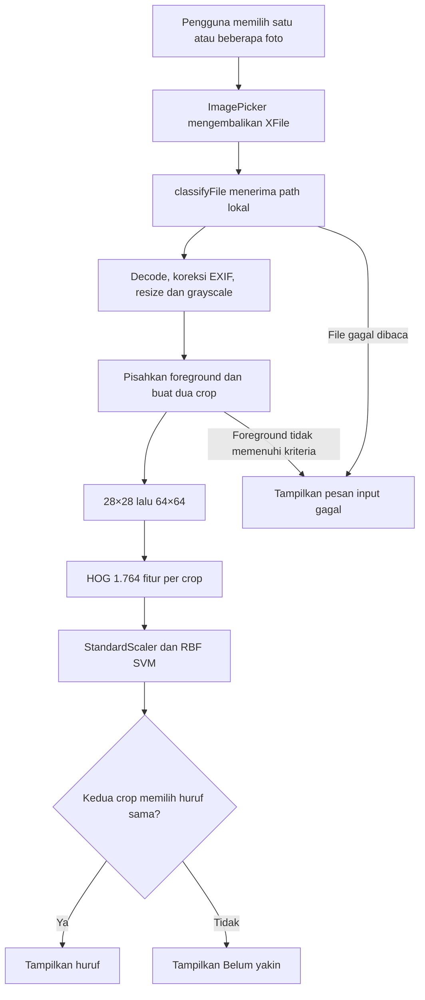

# Alur teknis upload foto LatihIsyarat

Dokumen ini mengikuti build **LatihIsyarat QA** untuk Android. Build tersebut memanggil backend SVM-HOG dari galeri atau dari set uji Drive. Sambungan ke layar Upload dari Silva tetap menjadi pekerjaan tim frontend.



## 1. Pilih foto dan buat permintaan

Pengguna menekan **Pilih satu foto** atau **Pilih banyak foto**. Flutter memakai `image_picker` melalui `ImagePicker.pickImage(source: ImageSource.gallery)` atau `pickMultiImage()`. Android membuka pemilih gambar sistem. Setelah pengguna memilih, Flutter menerima satu atau beberapa `XFile` yang menyediakan path file dan nama.

Widget QA meneruskan path ke `SvmHogClassifier.instance.classifyFile(path)`. Pada mode banyak foto, loop `for` menjalankan satu inferensi per file sesuai urutan yang dikembalikan picker. Setiap baris menyimpan nama foto, huruf kandidat, status, serta waktu proses. Jika satu file gagal, loop melanjutkan file berikutnya. Tombol dinonaktifkan saat batch berjalan untuk mencegah dua proses dimulai dari layar yang sama.

Tombol **Uji foto Drive** membaca daftar file dan huruf target dari manifest, kemudian memakai loop dan backend yang sama. Target hanya dipakai untuk menghitung benar atau salah setelah inferensi. Jalur ini memudahkan pengulangan dengan 24 berkas yang sama. [Layar QA](../tooling/svm_hog_photo_qa.dart)

## 2. Muat model dan jalankan di isolate

`initialize()` memuat `assets/models/svm_hog.bin.gz` lewat `rootBundle`. Gzip merupakan kompresi berkas. Aset berisi parameter hasil ekspor model RBF SVM augmented, termasuk support vector, koefisien, intersep, gamma, label, mean, dan scale. Ukuran berkasnya 63.615.075 byte atau 60,67 MiB.

Dart menjalankan inferensi di **isolate** khusus agar pekerjaan komputasi tidak menahan isolate antarmuka. `TransferableTypedData` mengirim bytes saat inisialisasi. `SendPort` dan `ReceivePort` membawa permintaan dan hasil. `initialize()` menggunakan ulang isolate dan model untuk file-file berikutnya. Service membatasi waktu tunggu respons inferensi hingga 10 detik dan melepas worker pada timeout agar permintaan berikutnya bisa memuat model lagi. Semua pemrosesan dilakukan di perangkat. [Service Dart](../lib/services/svm_hog_classifier.dart)

## 3. Decode dan koreksi orientasi foto

Backend memeriksa keberadaan file, membaca byte, lalu mengubah JPEG atau format yang didukung menjadi matriks piksel dengan `img.decodeImage()`. `img.bakeOrientation()` menerapkan orientasi EXIF langsung ke piksel, sehingga foto yang disimpan dengan metadata rotasi masuk ke tahap berikutnya sesuai orientasi tampilannya. File yang hilang atau gagal dibaca menghasilkan pesan pada foto itu.

Sisi terpanjang gambar diturunkan hingga maksimal **384 piksel** dengan rasio aspek dipertahankan. Interpolasi rata-rata meringkas piksel ketika gambar diperkecil. Gambar dengan sisi awal kurang dari 28 piksel ditolak. Ukuran 384 adalah batas kerja segmentasi.

## 4. Grayscale dan perkiraan latar

Untuk gambar berwarna, aplikasi mengubah RGB menjadi satu kanal grayscale memakai bobot `Y = 0.299R + 0.587G + 0.114B`. Kanal tunggal dipakai untuk menghitung tepi tangan. Setiap piksel hasilnya berada pada rentang 0–255.

Sistem menghitung histogram intensitas pada pita di sekeliling gambar. Tebalnya sekitar **5% dari sisi terpendek**. Median pita menjadi perkiraan intensitas latar. Selisih persentil ke-90 dan ke-10 mengukur keragaman latar di tepi. Jika rentangnya lebih dari 55, segmentasi menolak gambar karena tepi terlalu bervariasi untuk asumsi latar polos.

## 5. Segmentasi foreground dan bounding box

**Foreground segmentation** memisahkan bagian gambar yang berbeda dari latar. Untuk setiap piksel, kode menghitung selisih absolut antara intensitas piksel dan estimasi latar. Jika selisih mencapai ambang `max(18, round(1.25 × rentang persentil))`, piksel masuk ke mask biner.

**Connected-component labeling** mengelompokkan piksel mask dengan tetangga atas, bawah, kiri, dan kanan. Kode menelusuri komponen menggunakan antrean, mengambil komponen terbesar, lalu mencatat batas kiri, kanan, atas, dan bawah sebagai **bounding box**. Syarat penerimaan area mencakup luas 2–85% dari gambar, sisi kotak terbesar minimal 20 piksel, komponen kedua paling besar 35% dari komponen utama, serta kotak utama berada di dalam tepi gambar.

Titik tengah bounding box mengikuti lokasi objek sehingga tangan boleh berada di luar pusat foto. Segmentasi mengandalkan kontras dan konektivitas piksel. Benda dengan kontras kuat juga dapat masuk sebagai foreground, terutama bila memenuhi kriteria ukuran. [Decode dan segmentasi](../lib/services/svm_hog_input.dart)

## 6. Crop persegi, padding, dan resize

Aplikasi membuat dua crop dari pusat bounding box yang sama. Untuk jalur file foto pada percobaan terbaru, panjang sisi crop memakai **1,05× dan 1,12×** sisi terpanjang bounding box. Build awal di Vivo memakai 1,2× dan 1,4×. Bagian crop di luar foto diisi dengan intensitas perkiraan latar. Piksel grayscale di dalam crop tetap digunakan bersama detail pada tangan. Mask dipakai untuk mencari area.

Kedua crop diperkecil ke **28×28** dengan interpolasi rata-rata untuk mendekati resolusi sumber Sign Language MNIST. Selanjutnya gambar diubah ke **64×64** dengan interpolasi linear untuk memenuhi grid HOG. Crop persegi mempertahankan proporsi tangan. Langkah resize mengubah kisi piksel tanpa menambah detail sumber. Training MNIST memakai gambar 28×28 yang sudah siap sebagai input, sedangkan segmentasi dan dua crop merupakan penyesuaian untuk foto kamera atau galeri.

## 7. Ekstraksi fitur HOG

**Histogram of Oriented Gradients (HOG)** mengubah gambar menjadi angka yang merangkum arah dan kekuatan tepi. Jari, telapak, dan celah antarjari memengaruhi pola gradien. Aturan ekstraksi ditentukan saat implementasi dan berlaku sama untuk setiap gambar. Selanjutnya SVM mempelajari batas kelas dari pola fitur training.

1. Tiap piksel dinormalisasi ke 0–1 dengan pembagian 255, lalu memakai transformasi akar kuadrat untuk meredam pengaruh intensitas.
2. **Central difference** menghitung gradien horizontal `dx` dan vertikal `dy` dari selisih piksel bertetangga. Besarnya gradien adalah `sqrt(dx² + dy²)`. Arah diperoleh dengan `atan2` dan dipetakan ke 0–180°.
3. Gambar dibagi menjadi **8×8 sel**, tiap sel berisi **8×8 piksel**. Setiap sel memiliki **9 bin orientasi**, masing-masing mencakup interval 20°. Besar gradien menambah bobot pada bin arah yang sesuai.
4. **Block normalization L2-Hys** menggabungkan empat sel dalam blok 2×2. Vektor blok dinormalisasi dengan norma L2, dibatasi hingga 0,2, lalu dinormalisasi kembali agar perubahan kontras lokal tidak terlalu mendominasi.
5. Blok bergeser satu sel. Ada 7×7 posisi blok dengan 36 angka per blok. Panjang vektor akhirnya **7 × 7 × 4 × 9 = 1.764 fitur** untuk setiap crop.

## 8. StandardScaler

**StandardScaler** menstandarkan tiap fitur HOG berdasarkan statistik training. Untuk fitur ke-`j`, rumusnya `z[j] = (x[j] − mean[j]) / scale[j]`. Mean dan scale disimpan bersama model. Saat pengguna mengunggah foto, keduanya diambil dari aset sehingga semua foto berada pada skala fitur yang sama. Normalisasi piksel, L2-Hys, dan StandardScaler terjadi di tiga tahap dengan fungsi yang berbeda.

## 9. Prediksi dengan RBF SVM

**Support Vector Machine (SVM)** membedakan kelas berdasarkan batas keputusan. Model memakai kernel **Radial Basis Function (RBF)** yang menghitung kemiripan antara vektor masukan standar dan support vector melalui `exp(−gamma × ||x − v||²)`. Model ini memiliki **10.446 support vector**, `C = 100`, dan `gamma = scale` yang saat training menghasilkan sekitar `0.0005668934`. Parameter `C` mengatur penalti kesalahan training terhadap lebar margin. Gamma mengatur seberapa cepat kemiripan turun saat jarak fitur membesar.

Untuk 24 kelas, LIBSVM menggunakan **one-versus-one**, yaitu **276 pasangan kelas**. Setiap pasangan memiliki fungsi keputusan dengan koefisien dan intersep. Tanda margin menentukan suara untuk salah satu kelas pada pasangan itu. Kelas dengan suara terbanyak menjadi prediksi. Skor keputusan juga tersedia dalam urutan label dan menggabungkan jumlah suara dengan koreksi dari margin. Persentase peluang membutuhkan kalibrasi tersendiri. [HOG dan SVM](../lib/services/svm_hog_model.dart)

## 10. Ubah hasil inferensi menjadi hasil di layar

Backend menghasilkan `SvmHogPrediction` dengan tiga informasi. `label` adalah prediksi dari jalur keputusan yang dipilih, `scores` adalah 24 skor keputusan, dan `accepted` menandai kesepakatan dalam pasangan input. Untuk build awal yang tercatat di bagian 12, pasangan ini adalah dua crop standar. Bagian 15 menjelaskan perubahan pada build terbaru.

| Kondisi | Keluaran layar QA |
| --- | --- |
| Dua crop memilih huruf yang sama | Huruf prediksi |
| Dua crop memilih huruf yang berbeda | Belum yakin |
| File bermasalah atau foreground gagal dipisahkan | Pesan sesuai masalah input |
| Inferensi mengalami masalah sistem | Pesan kegagalan per foto |

Kesepakatan crop mengukur kestabilan terhadap dua ukuran framing. Prediksi yang disepakati masih bisa salah. Dukungan model mencakup 24 huruf statis **A–Y dengan J dikecualikan**. J dan Z pada ASL memerlukan informasi gerak.

## 11. Augmentasi saat training

Model terpilih menggunakan 21.963 gambar training asli ditambah 7.688 variasi, total **29.651** input training. Augmentasi mengubah rotasi hingga ±10°, pergeseran hingga 5%, skala 0,9–1,1, brightness sekitar ±10, kontras 0,9–1,1, dan menambahkan blur atau noise ringan pada sebagian gambar. Variasi ini dibuat saat training. Dua crop saat inferensi bertujuan memeriksa prediksi pada dua framing foto yang sama.

Hasil validation internal kandidat augmented adalah accuracy dan macro-F1 100%. Angka official test MNIST 95,93% berasal dari kandidat tanpa augmentasi. Kandidat augmented yang dipasang di Vivo memiliki evaluasi foto nyata tersendiri. [Training](../training/SVM_HOG/train_svm_hog.py) · [Metadata model](../training/SVM_HOG_FINAL_AUGMENTED/model_metadata.json)

## 12. Hasil pengujian per foto di Vivo

Uji ini dijalankan dari tombol **Uji foto Drive** di aplikasi LatihIsyarat QA pada Vivo 1918. Set berisi 24 foto berwarna berlatar polos, satu foto per huruf statis. File diambil dari salinan folder Drive dan diverifikasi dengan SHA-256 pada manifest. Label target berasal dari manifest. [Folder foto sumber](https://drive.google.com/drive/folders/18cFgSn6ePkU_srS4W2MLa5_2aAd3QOM3)

Pemilih foto Android berhasil terbuka di Vivo. Pemilihan file hingga kembali ke hasil belum terkonfirmasi dalam pengujian galeri ini. Tabel di bawah mencatat hasil dari tombol **Uji foto Drive**, yang menjalankan backend dari daftar foto uji lokal.

- **8 benar**, **10 salah**, dan **6 belum yakin**. Seluruh foto berhasil melewati segmentasi. Enam hasil “Belum yakin” terjadi karena kedua crop berbeda prediksi.
- **33,33%** benar dari 24 foto. Sebanyak 18 foto menghasilkan huruf, dengan 8 dari 18 prediksi tepat (44,44%). Prediksi yang disepakati kedua crop masih bisa keliru, misalnya A terbaca N dan K terbaca V.
- Model dimuat dalam **2.132 ms**. Waktu pemrosesan per foto pada build debug rata-rata **1.605 ms**, dengan rentang **1.260–3.134 ms**. Waktu ini mencakup pembacaan file, praproses, dan dua inferensi setelah model siap.

| Foto | Target | Tampil di QA | Status | Waktu (ms) |
| --- | :---: | :---: | --- | ---: |
| a.jpg | A | N | Salah | 3.134 |
| b.jpg | B | B | Benar | 1.799 |
| c.jpg | C | E | Salah | 1.482 |
| d.jpg | D | V | Salah | 1.317 |
| e.jpg | E | E | Benar | 1.278 |
| f.jpg | F | Belum yakin | Crop berbeda | 1.318 |
| g.jpg | G | G | Benar | 1.260 |
| h1.jpg | H | H | Benar | 1.317 |
| i1.jpg | I | I | Benar | 1.292 |
| k1.jpg | K | V | Salah | 1.429 |
| l1.jpg | L | L | Benar | 1.317 |
| m1.jpg | M | Belum yakin | Crop berbeda | 1.467 |
| n1.jpg | N | Belum yakin | Crop berbeda | 1.397 |
| o1.jpg | O | Belum yakin | Crop berbeda | 1.611 |
| p1.jpg | P | Belum yakin | Crop berbeda | 1.683 |
| q1.jpg | Q | M | Salah | 1.768 |
| r1.jpg | R | V | Salah | 1.453 |
| s1.jpg | S | N | Salah | 1.489 |
| t1.jpg | T | Belum yakin | Crop berbeda | 1.913 |
| u1.jpg | U | V | Salah | 2.158 |
| v1.jpg | V | W | Salah | 1.565 |
| w1.jpg | W | W | Benar | 1.620 |
| x1.jpg | X | D | Salah | 1.681 |
| y1.jpg | Y | Y | Benar | 1.782 |

Semua hasil di atas berlaku untuk set Drive ini. Satu foto per kelas belum cukup untuk mengukur ketahanan pada variasi pose, orang, dan pencahayaan. Seluruh file memberi hasil yang sama dengan uji diagnostik Dart di komputer. Penurunan performa dari validation MNIST konsisten dengan perbedaan antara contoh training terkontrol dan foto eksternal.

## 13. Aplikasi uji dan penggunaan

Pada Vivo, buka **LatihIsyarat QA**. Tombol **Uji foto Drive** menjalankan ulang 24 foto yang sudah dimasukkan. **Pilih satu foto** dan **Pilih banyak foto** membuka pemilih gambar sistem untuk uji tambahan.

Build ini memakai entry point `tooling/svm_hog_photo_qa.dart` dengan ID paket `com.example.sign_language.svmqa`. Untuk membuatnya ulang dari PowerShell setelah `flutter pub get`, jalankan perintah ini dari root proyek.

```powershell
$target = (Resolve-Path tooling/svm_hog_photo_qa.dart).Path
Push-Location android
try {
    .\gradlew.bat '-PsvmHogQa=true' "-Ptarget=$target" '-Ptarget-platform=android-arm64' :app:assembleDebug
} finally {
    Pop-Location
}
```

APK hasil Gradle tersedia di `build/app/outputs/apk/debug/app-debug.apk`. Set Drive uji dimuat terpisah ke direktori dokumen aplikasi. Aplikasi mencatat hasil tombol **Uji foto Drive** dalam `app_flutter/svm_qa_report.json` yang dapat dibaca dengan `adb exec-out run-as com.example.sign_language.svmqa cat app_flutter/svm_qa_report.json` pada build debug.

## 14. Percobaan perbaikan crop

Pada set Drive, seluruh gambar lolos segmentasi. Saya menguji enam ukuran crop, tiga ukuran gambar sebelum HOG (28, 40, dan 64 piksel), serta inversi intensitas untuk latar terang. Semua percobaan memakai model SVM yang sama. Perubahan crop saja menghasilkan angka berikut pada uji lokal.

| Crop | Benar | Salah yang lolos | Belum yakin |
| --- | ---: | ---: | ---: |
| 1,20× dan 1,40× | 8/24 (33,33%) | 10 | 6 |
| 1,05× dan 1,12× | 11/24 (45,83%) | 9 | 4 |

Pada input 28×28, crop yang lebih rapat memberi tangan lebih banyak piksel. HOG menghitung distribusi arah tepi pada sel tetap, sehingga perubahan ukuran tangan dapat menggeser pola tepi ke sel yang berbeda. Pengaruhnya terlihat pada hasil kedua crop.

| Foto | Dua prediksi lama | Dua prediksi rapat | Hasil rapat |
| --- | :---: | :---: | --- |
| A | N / N | A / A | Benar |
| F | F / B | F / F | Benar |
| V | W / W | V / V | Benar |
| S | N / N | S / N | Belum yakin |
| N | O / N | O / O | Salah yang lolos |
| C | E / E | E / E | Salah yang lolos |
| K | V / V | U / U | Salah yang lolos |

C, K, dan U tidak mencapai label target pada konfigurasi yang dicoba. Temuan ini mengarahkan pemeriksaan berikutnya ke kesesuaian fitur HOG antara foto asli dan data training. Pada foto lain di luar set Drive, 73 dari 73 berkas lolos pembacaan gambar lalu berhenti di pemeriksaan variasi tepi sebelum crop dan inferensi. Artinya, percobaan ini memperbaiki framing pada foto berlatar polos. Separasi tangan dari latar ramai tetap menjadi batas penggunaan backend saat ini.

Ukuran crop dipilih dari hasil eksplorasi pada set Drive, sehingga 45,83% adalah angka pengembangan. Konfigurasi 40×40 dengan inversi menghasilkan 12 benar, 10 salah yang lolos, dan 2 belum yakin. Percobaan lanjutan memakai 28×28 dan crop rapat karena perubahan ini menguji satu faktor dan menurunkan jumlah prediksi salah yang lolos. Pengukuran berikutnya perlu memakai foto berlabel yang belum dipakai untuk memilih konfigurasi, termasuk pose dari beberapa orang dan sesi. Jalankan probe dengan opsi `--wide` untuk mengulang nilai awal.

## 15. Perbandingan variasi input

Backend foto menguji dua variasi dari crop 1,05×. Variasi pertama membalik intensitas piksel dengan rumus `255 - I` pada citra 64×64. Variasi kedua memakai resolusi antara 40×40 sebelum resize ke 64×64. Jika kedua prediksi sepakat, backend mengembalikan huruf tersebut. Jika berbeda, backend memakai aturan kesepakatan dua crop standar. HOG, scaler, dan parameter SVM yang digunakan sama pada seluruh variasi.

| Kondisi | Sebelumnya (benar / salah / ragu) | Terbaru (benar / salah / ragu) |
| --- | ---: | ---: |
| 24 foto asli | 11 / 9 / 4 | 13 / 8 / 3 |
| Rotasi sintetis −8° | 9 / 14 / 1 | 10 / 14 / 0 |
| Rotasi sintetis +8° | 13 / 9 / 2 | 13 / 9 / 2 |
| Intensitas diturunkan | 11 / 7 / 6 | 12 / 7 / 5 |
| Blur | 11 / 8 / 5 | 13 / 8 / 3 |
| Total | 55 / 47 / 18 | 61 / 46 / 13 |

Pada foto asli, hasil Q berubah dari M ke Q dan S berubah dari “Belum yakin” ke S. Hasil ini diperoleh di komputer dari 24 foto Drive yang juga digunakan untuk memilih aturan. Empat variasi sintetis per foto memberikan 120 input, dengan 24 foto sumber. Jalankan probe dengan `--baseline` untuk pembanding dua crop standar atau tanpa opsi untuk aturan terbaru.

Segmentasi latar polos tetap menentukan apakah citra masuk ke SVM. Pada uji sebelumnya, pemeriksaan variasi tepi menolak semua 73 foto pribadi. Evaluasi crop manual pada set tersebut menghasilkan dua huruf benar, 56 salah, dan 15 ragu. Pengujian itu menjadi dasar untuk memisahkan masalah segmentasi dan generalisasi model pada foto asli.

## 16. Koreksi pencahayaan dan verifikasi di Vivo

Backend foto mencoba meratakan pencahayaan ketika variasi intensitas tepi melebihi 55. Sistem mengambil median intensitas di empat sudut dan memperkirakan tingkat pencahayaan pada setiap piksel dengan interpolasi bilinear. Koreksi berjalan jika minimal 90% piksel pada masing-masing tepi berada dalam selisih 12 tingkat intensitas dari perkiraan. Piksel dibagi dengan perkiraan pencahayaan setempat dan dikalikan dengan median tepi, lalu hasilnya diteruskan ke segmentasi dan HOG.

| Set uji | Sebelum (benar / salah / ragu / ditolak sebelum SVM) | Sesudah (benar / salah / ragu / ditolak sebelum SVM) |
| --- | ---: | ---: |
| 24 foto Drive asli | 13 / 8 / 3 / 0 | 13 / 8 / 3 / 0 |
| Gradien horizontal | 0 / 0 / 0 / 24 | 12 / 9 / 3 / 0 |
| Gradien vertikal | 0 / 0 / 0 / 24 | 12 / 8 / 4 / 0 |
| Gradien diagonal | 0 / 0 / 0 / 24 | 12 / 10 / 2 / 0 |
| Bayangan tajam dua sisi | 0 / 0 / 0 / 24 | 0 / 0 / 0 / 24 |
| Tujuh kontrol negatif | 0 / 0 / 0 / 7 | 0 / 0 / 0 / 7 |
| 73 foto pribadi berlatar bervariasi | 0 / 0 / 0 / 73 | 0 / 0 / 0 / 73 |

Tabel membandingkan 200 input lokal dengan koreksi dimatikan dan dinyalakan. Kondisi gradien dan bayangan berasal dari transformasi terhadap 24 foto Drive yang sama.

Pada Vivo 1918, build QA commit `13c689f` menghasilkan **13 benar, 8 salah, dan 3 ragu** pada foto asli. Uji Vivo pada 24 turunan gradien horizontal menghasilkan **12 benar, 9 salah, dan 3 ragu**. Kedua batch dijalankan dari tombol **Uji foto Drive**. Pemrosesan rata-rata sekitar 523 ms per foto asli dan 447 ms per foto gradien pada sesi tersebut.

## 17. Lima iterasi perbaikan foto

Set pembanding berisi 24 foto Drive asli dan tujuh turunan per foto, yaitu rotasi kiri dan kanan 8°, pengurangan intensitas, blur, dan tiga arah gradien. Ada 192 input dari 24 foto sumber. Bayangan dua zona, tujuh kontrol negatif, dan 73 foto pribadi dilaporkan terpisah. Pemilihan perubahan memakai set pengembangan yang sama. Bobot SVM dan konfigurasi HOG sama dalam semua perbandingan.

| Iterasi | Perubahan yang diuji | Drive asli (benar / salah / ragu) | 192 input (benar / salah / ragu) | Keputusan |
| --- | --- | ---: | ---: | --- |
| Awal | Empat tampilan crop dan aturan persetujuan yang sudah dipakai | 13 / 8 / 3 | 97 / 73 / 22 | Pembanding |
| 1 | Ratakan latar di luar komponen utama dengan mask | 13 / 8 / 3 | 95 / 76 / 21 | Batalkan. Foto asli seri dan hasil gabungan turun |
| 2 | Regangkan kontras crop menurut persentil 1 dan 99 | 11 / 11 / 2 | 91 / 88 / 13 | Batalkan. Lanjutkan iterasi pencahayaan dengan koreksi bayangan dua zona sebelum segmentasi |
| 3 | Ubah ukuran antara cek foto dari 40 ke 64 piksel | 12 / 9 / 3 | 95 / 75 / 22 | Batalkan. Q berubah dari benar menjadi M |
| 4 | Coba ulang hasil ragu dengan dua rotasi crop ±6° | 13 / 9 / 2 | 97 / 77 / 18 | Batalkan. O diterima sebagai M dan jumlah benar tetap |
| 5 | Jumlahkan skor dari empat tampilan dan minta persetujuan minimal dua tampilan | 12 / 8 / 4 | 96 / 80 / 16 | Batalkan. Q menjadi ragu dan P diterima sebagai N |

### Koreksi yang diterapkan

Jika koreksi cahaya bertahap gagal, backend foto dapat mengoreksi bayangan dengan batas lurus yang membagi foto menjadi dua zona. Backend membandingkan kecerahan di empat sudut, mencari letak perubahan pada dua tepi yang berlawanan, lalu menerima perkiraan pencahayaan hanya jika posisi batas dan pola intensitas tepi konsisten. Piksel diratakan menurut zona masing-masing sebelum segmentasi memilih komponen tangan. Kamera live memakai jalur yang sama seperti sebelumnya.

| Pengujian | Sebelum (benar / salah / ragu / ditolak sebelum SVM) | Sesudah (benar / salah / ragu / ditolak sebelum SVM) |
| --- | ---: | ---: |
| 24 foto Drive asli, lokal dan Vivo 1918 | 13 / 8 / 3 / 0 | 13 / 8 / 3 / 0 |
| 24 foto turunan dengan batas bayangan vertikal di tengah, lokal | 0 / 0 / 0 / 24 | 13 / 9 / 2 / 0 |
| Set bayangan vertikal di tengah, Vivo 1918 | Belum diuji pada versi awal di Vivo | 13 / 9 / 2 / 0 |
| 24 foto turunan dengan batas bayangan horizontal di 43% tinggi, lokal | — | 13 / 9 / 2 / 0 |
| 24 foto turunan dengan batas bayangan vertikal di 37% lebar, lokal | — | 11 / 12 / 1 / 0 |
| 7 kontrol negatif, lokal | 0 / 0 / 0 / 7 | 0 / 0 / 0 / 7 |
| 73 foto pribadi, lokal | 0 / 0 / 0 / 73 | 0 / 0 / 0 / 73 |

Hasil per foto pada 192 input pembanding tetap sama setelah koreksi. File yang dipakai di Vivo dicocokkan berdasarkan checksum. Pengukuran sebelum dan sesudah untuk foto asli memakai aplikasi LatihIsyarat QA. `flutter analyze --no-pub` bersih dan 123 tes Flutter lulus.

### Letak kegagalan yang tersisa

- **Segmentasi latar.** Seluruh 73 foto pribadi berhenti pada pemeriksaan tepi sebelum HOG dan inferensi. Koreksi bayangan hanya menangani pola cahaya yang bentuknya sesuai dengan perkiraan di atas.
- **Citra dan klasifikasi.** Semua 24 foto Drive asli masuk ke SVM. Kesalahan yang diterima adalah C→E, D→V, K→U, M→O, N→O, R→V, U→V, dan X→D. Pada tujuh dari delapan foto itu, huruf target tidak menjadi prediksi teratas pada satu pun dari empat tampilan crop. Foto N mendapat satu prediksi N dan tiga prediksi O. Percobaan ini memperlihatkan pengaruh tampilan crop. Kontribusi ketepatan crop dan perbedaan data training belum bisa dipisahkan sepenuhnya.
- **Aturan penerimaan.** O, P, dan T tetap ragu. Huruf target juga absen dari prediksi teratas pada empat tampilan standar untuk ketiganya. Melonggarkan keputusan hanya menambah kesalahan pada beberapa foto. Pada uji bayangan di Vivo, P justru diterima sebagai N, sehingga pemulihan segmentasi perlu dinilai bersama jumlah salah yang diterima.

Pengukuran berikutnya perlu memakai foto berlabel dari orang dan sesi baru. Untuk memperbaiki dua tahap yang tersisa, ukur lokalisasi tangan pada latar ramai dan uji ulang SVM pada crop tangan terverifikasi. Jika huruf tetap salah pada crop yang bagus, diperlukan data training yang lebih mewakili foto kamera untuk memperbaiki SVM-HOG.
