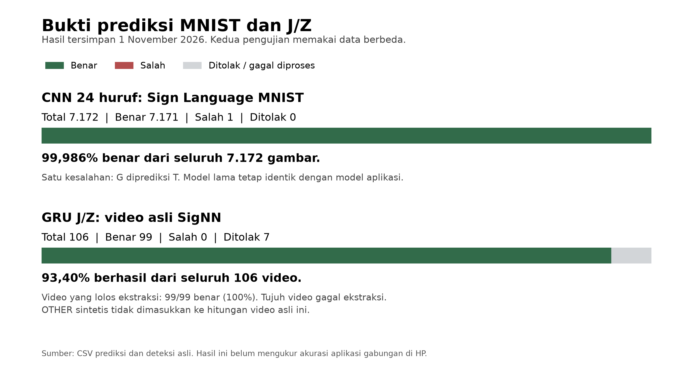

# Hasil training 1 November 2026

Laporan ini berfokus pada benchmark Sign Language MNIST untuk CNN 24 huruf dan eksperimen gerakan J/Z. Hasil MNIST tidak mewakili akurasi seluruh foto nyata atau kamera HP.

Training selesai dalam 47 menit 39 detik, termasuk unduhan, evaluasi, dan pemrosesan data. CNN 24 huruf tetap sama dengan model aplikasi. Model baru yang dilatih adalah GRU untuk gerakan J, Z, dan OTHER.

## Metode dan data

MediaPipe mengambil 21 titik tangan dari video. Gerakannya disusun menjadi 48 langkah, lalu dipelajari GRU dengan 27.139 parameter. Training memakai seed 42 dan pembagian data memakai seed 2026. Checkpoint dipilih berdasarkan validation loss, dengan hasil terbaik pada epoch 60.

Dataset SigNN berisi 712 video, dibagi menjadi 500 training, 106 validation, dan 106 test sebelum augmentasi. Setelah penyaringan deteksi tangan, masing-masing tersisa 461, 100, dan 99 video. Penambahan OTHER sintetis menghasilkan 922, 200, dan 198 sampel. Rincian data ada di [DATASET](../DATASET/README.md).

## Hasil prediksi

| Pengujian | Total | Benar | Salah | Ditolak atau gagal diproses |
| --- | ---: | ---: | ---: | ---: |
| CNN, official test MNIST | 7.172 gambar | 7.171 | 1 | 0 |
| GRU, video asli J/Z | 106 video | 99 | 0 | 7 |

CNN mencapai **99,986% pada MNIST**. Satu kesalahan adalah huruf G yang diprediksi T. Model lama tidak dilatih ulang dan hash-nya tetap sama.

GRU mengenali **43 J dan 56 Z dengan benar**, sehingga akurasi pada 99 video yang berhasil diproses adalah **100%**. Empat video J dan tiga video Z gagal ekstraksi. Jika seluruh 106 video dihitung, keberhasilan alurnya **93,40%**.

OTHER menghasilkan 99 prediksi benar dari 99 sampel sintetis berdasarkan kelas dengan skor tertinggi. Sampel ini turunan video test, bukan 99 video negatif nyata. Kemampuan menolak gerakan biasa belum terukur.

## Ukuran dan status model

| Model | Ukuran |
| --- | ---: |
| CNN 24 huruf, tetap | 318,46 KiB |
| GRU J/Z float16 | 224,29 KiB |
| Kedua file model | 542,75 KiB |

Ekspor J/Z float16 cocok 100% dengan label Keras pada 128 sampel validation. Hasil test GRU berasal dari checkpoint Keras. Model belum diuji di Vivo atau diintegrasikan ke aplikasi. Langkah berikutnya adalah menyambungkan urutan landmark, mengatur keputusan CNN dan GRU, lalu menguji gerakan J/Z serta gerakan lain.

## Bukti yang bisa dibuka

| Bukti | Yang ditunjukkan |
| --- | --- |
| [Grafik training J/Z](bukti/JZ_training_curves.png) | Accuracy dan loss training serta validation |
| [Confusion matrix J/Z](bukti/JZ_confusion_matrix.png) | 43 J, 56 Z, dan 99 OTHER sintetis, tanpa salah klasifikasi |
| [Confusion matrix MNIST](bukti/CNN_MNIST_confusion_matrix.png) | Kesalahan per huruf pada 7.172 gambar |
| [Contoh satu kesalahan MNIST](bukti/MNIST_SATU_KESALAHAN.png) | Gambar asli berlabel G yang diprediksi T |
| [Prediksi MNIST](bukti/CNN_MNIST_predictions.csv), [J/Z](bukti/JZ_test_predictions.csv) | Catatan prediksi per sampel |
| [Deteksi video](bukti/JZ_video_detection_coverage.csv) | Video yang lolos atau gagal beserta alasannya |

Angka bersumber dari ZIP `training_20261101_100558_262805_utc_596593ce_LENGKAP.zip`. File JSON/CSV asli disertakan dalam `bukti/`, dengan pemetaan sumber dan hash di [ASAL_BUKTI.csv](bukti/ASAL_BUKTI.csv). Gambar ringkasan dan contoh kesalahan MNIST dibuat dari data asli serta prediksi tersimpan. Bukti ini tidak menggantikan pengujian aplikasi di HP.
